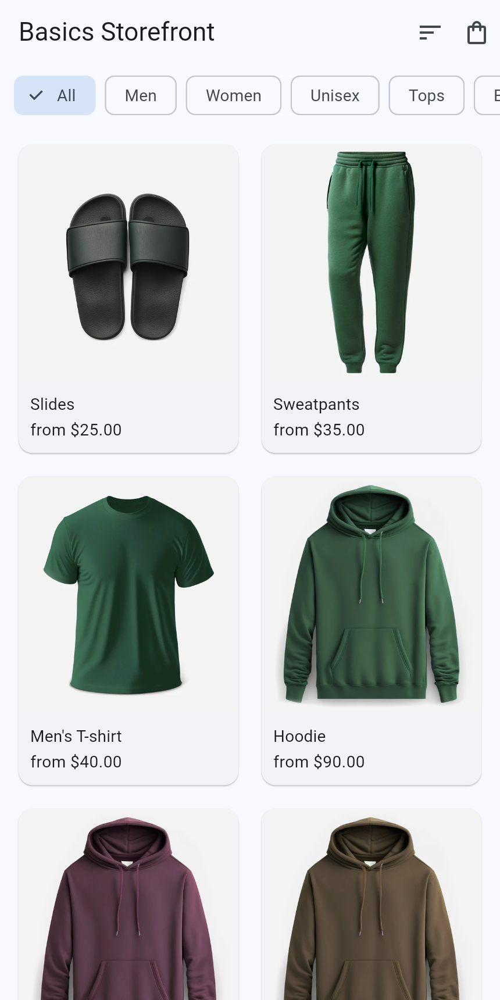

# Basics Storefront

A small, production-shaped **Flutter e-commerce app** built against the
**Shopify Storefront GraphQL API**: browse products, pick a variant, manage a
server-side Shopify cart, and hand off to Shopify's hosted checkout.

It runs out of the box with zero credentials against
[mock.shop](https://mock.shop) — Shopify's public mock Storefront API — and
switches to a real shop with two `--dart-define`s.

**[Live web demo](https://moeing747.github.io/flutter-shopify-storefront/)** —
the same codebase compiled for the web, framed at phone width. An installable
arm64 APK is built by CI on every push and can be downloaded from the latest
[Actions run](https://github.com/moeing747/flutter-shopify-storefront/actions)
(artifact `app-release-apk`).

```bash
flutter pub get
flutter run            # uses https://mock.shop/api by default
```



An end-to-end smoke test drives the real flow (catalog → product → add to
cart → cart) against the live API on a device or simulator:

```bash
flutter test integration_test -d <device-id>
```

## Why it looks the way it does

### Architecture

```
lib/
  core/            config (flavors/brands), GraphQL client, shared domain (Money)
  features/
    catalog/       product grid
    product/       detail + variant selection
    cart/          Shopify cart mutations, cart state, checkout hand-off
      domain/      models + repository interface (no Flutter, no GraphQL)
      data/        GraphQL implementation of the repository
      application/ Riverpod controllers/providers
      presentation/ widgets
```

The load-bearing decision: **widgets never see GraphQL.** Each feature's UI
and state depend on a repository *interface*; the GraphQL implementation is
injected via Riverpod. That one boundary is what makes the whole app testable
(see below) and lets the transport evolve (new API version, different client
library, adding a cache) without touching a single widget.

Other choices, briefly:

- **Riverpod** for state and dependency injection — provider overrides give
  compile-safe fakes in tests, and `AsyncNotifier` models the cart's
  loading/error/data lifecycle without boilerplate.
- **graphql_flutter** as the client. `ferry` (full codegen) was considered;
  for an app this size the codegen overhead outweighs the type-safety win,
  and the repository layer already contains all response mapping in one
  reviewable place. With a growing schema I'd revisit this.
- **The cart lives server-side** (Shopify cart mutations, cart ID held in a
  controller). Checkout is a hand-off to Shopify's hosted `checkoutUrl`, so
  payment never touches app code and PCI scope stays at zero.
- **Money stays decimal-safe** — amounts are kept as strings from the API and
  only parsed for display formatting, never for arithmetic.
- **Prices show CAD in the demo** because mock.shop's data is a Canadian
  demo store with no other markets configured (it accepts `@inContext` but
  has no localized pricing). The app is currency-agnostic — it renders
  whatever `MoneyV2` the API returns, so against a real EUR shop everything
  is in euros with zero code change.

### Shops as build flavors

`AppConfig` reads endpoint, token and brand from `--dart-define`. A company
with several shops can ship one app per shop from this single codebase:
theme, name and endpoint switch at build time.

```bash
flutter run --dart-define=BRAND=outlet
flutter run \
  --dart-define=STOREFRONT_ENDPOINT=https://SHOP.myshopify.com/api/2025-07/graphql.json \
  --dart-define=STOREFRONT_TOKEN=PUBLIC_STOREFRONT_TOKEN \
  --dart-define=BRAND=basics
```

### Testing: how the GraphQL API is mocked

Three layers, each mocking at a different boundary — this is deliberate:

| Layer | Boundary mocked | What it proves |
|---|---|---|
| `test/data/*` | GraphQL **Link** replays fixtures recorded verbatim from mock.shop (`test/fixtures/*.json`, `__typename` included — the real wire shape) | Query documents, variables, response→domain mapping, and Shopify `userErrors` handling match the actual API contract |
| `test/features/*` | **Repository** (mocktail) | Cart controller logic: first add creates a cart, later adds reuse it; a failed mutation surfaces the error and rolls back to the last good cart |
| `test/widget/*` | **Repository** (hand-written fakes) | Real UI flows — variant selection, add-to-cart, loading/empty/error states — with zero network and zero GraphQL |

```bash
flutter test
```

### Release

See [RELEASE.md](RELEASE.md) for the store pipeline (signing, tracks, staged
rollout) and app-size policy. CI (GitHub Actions) formats, analyzes, tests,
builds a release bundle, and reports its size on every push — the app is
designed to stay **under 20 MB** installed (network images, tree-shaken
icons, per-ABI splits).

## What I'd do next

- Localization (`flutter_localizations` + German strings) — prices already
  format per locale via `intl`.
- Sentry + store-release automation via fastlane/codemagic.
- Search, filters, and per-line cart busy states.
